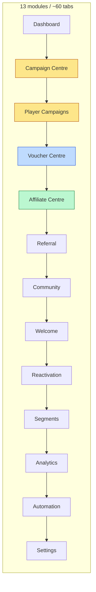

# 2. Current and proposed workflows (Phases 2, 5, 6, 7)

Reading guide. §A = current journeys as the code behaves today. §B = shared interaction rules. §C–§G = redesign per workflow family (CURRENT → PROPOSED, with the eight things Phase 2 asks for). §H = feasibility ledger (endpoint used per step; **new API only where flagged ➕**).
Counts are *estimates from code reading* (convention in `01-audit-inventory.md §1.0`).

## A. Current workflow map

Where one *task* crosses modules today:

| Admin task | Modules touched today |
|---|---|
| "Give a voucher to a campaign's winners" | Player Campaigns (create) → Voucher Centre (stock) → Player Campaigns › Rewards (pool) |
| "Is this affiliate OK to pay?" | Affiliate › Overview (find) → Segments › All Players (risk) → Referral › Performance (invitees) → Affiliate › Pending Approval (act) |
| "Add codes" | Voucher Centre (drops), Affiliate › Voucher Batches (affiliate/welcome), Affiliate › Pending Approval (shortage), Player Campaigns › Rewards (pools), Reactivation (comeback pools) — **5 places, 5 forms** |
| "Add XP to a player" | Segments › Adjust XP (hidden under analytics) |

### A.1 Create a pooled voucher drop (V1) — ● traced, 6 interactions
`Voucher Centre` → `Active Drops` → scroll past list → Name → Start (datetime) → paste codes → **Create Drop**. Server: insert `drops` doc → validate/insert codes (`ordered=False`) → bump `public_remaining`. Outcomes: toast `Voucher drop created: <24-hex id>` or `Create failed: duplicate_code`. No preview, no confirm, drop may already exist when the error shows.

### A.2 Upload affiliate voucher codes (A6) — ● traced, 6–7 interactions
`Affiliate Centre` → `Voucher Batches` → Batch name → (Pool: default $5) → Entitlement month → paste codes → **Create Batch**. Inline preview line mirrors `normalize_voucher_codes` (unique/duplicate/invalid counts) but cannot know codes already in the database. Plain-English server errors. ✔ strongest flow in the repo.

### A.3 Review and approve affiliate rewards (A2/A3/A5) — ● traced
`Affiliate Centre` → `Pending Approval` → status chip → table of **user ID / tier / month / eligible tier / qualified (month) / risk flags** → Approve (`confirm()`), Reject (`prompt()` — Cancel still rejects), Approve All (`confirm()`), Reject All (`confirm` + typed + `prompt`). Pending Manual shows the shortage panel → Upload (modal) → *separately* Retry All.

### A.4 Create a Player Campaign (P1→P2) — ● traced, 9 to draft, then ≥ 3 more to live
`Player Campaigns` → `+ New Campaign` → type card → name → Next → start → Next → setup → Next → **Create** → (Campaign Detail, draft) → configure destination / provider / readiness → **Publish** → confirm. Readiness blockers are discovered by the server error on Publish.

### A.5 Campaign Builder (C2) — ● traced, ~16 typical / ~11 minimum
`Campaign Centre` → `Templates` → `+ New` → name → type → [step 2 audience] → [step 3 release, optional batch] → [step 4 reward + paste codes] → **Run Preview** (saves draft) → [step 6] type `LAUNCH` → **Compile & Launch**. Steps are free-jump buttons, not a gated sequence.

### A.6 XP adjust (S2) — ● traced, 5 interactions
`Segments` → `Adjust XP` → @username → amount → **Submit**. Result line only.

## B. Shared interaction rules (applied in every redesigned flow)

### B.1 Confirmation tiers — one component, strictness by consequence

| Tier | When | Pattern | Examples |
|---|---|---|---|
| **T0** | Read, filter, navigate | none | search, tabs |
| **T1** | Reversible, low blast radius | do it + toast with **Undo / reverse action** | pause a campaign, mission or batch campaign (each has a real resume), disable a banner. **Not** pausing a drop: the drops API has no plain resume (see C.3) |
| **T2** | Consequential but recoverable | **Review modal**: plain-language summary of *what changes and who is affected*, primary button names the action ("Create drop and go live") | create drop, upload codes, start drop, approve one reward, **reject one reward (reason required)**, retry waiting rewards, publish campaign |
| **T3** | Irreversible, money-moving at scale, or live-to-all | T2 summary **plus** typed phrase containing the number ("APPROVE 12", "REJECT 12", "LAUNCH") and, for rejects, a required reason picker | bulk approve/reject, Builder launch, end drop that has claims, delete anything, replace global bonus, XP change ≥ threshold |

Where a flow ends in a **Review stage** (create drop, publish campaign), that stage *is* the T2 confirmation and no second dialog is added. Replaces: native `confirm()`, `prompt()`, two modal helpers and two typed variants. Existing `confirmTyped`/`confirmSimple` modals are the implementation base (no new dependency).
**Rule of thumb for the T2/T3 split is a product decision**; the boundary above is a proposal (see README decision 5). The XP threshold is a **configurable constant, starting suggestion 1,000** — a policy number, not derived from code.

### B.2 Universal form behaviours
1. **Inline validation** on blur/paste, not on submit; errors sit under the field, in plain words, with the fix ("That time is in the past — pick a later time or choose *Start now*").
2. **One error dictionary** (server code → sentence). 43 call sites that print raw codes route through it; unknown codes show "Something went wrong and we can't confirm the result" + a copyable support code. Existing maps (`AFF_BATCH_ERROR_MESSAGES`, `gcActionErrorMessage`, `gcVisibilityReasonText`) are merged, not rewritten.
3. **Double-submit guard**: button disables and shows progress; the request carries a client idempotency key (server ignores it today — see risk R-4, so a server-side guard is a roadmap item, not assumed).
4. **After-action summary** instead of a bare toast for T2/T3: what was created/changed, counts, the next sensible action ("12 drops live → *Add codes*, *View drop*").
5. **Keep my typing**: failed submits never clear the form (the legacy `DropSubmissionController` already does this).
6. **KL time** always labelled; one date-time control with presets (*Now*, *Tonight 8 pm*, *Tomorrow 9 am*, *Pick…*) writing the same `YYYY-MM-DD HH:MM:SS` string the API wants.
7. **Advanced drawer** ("Show advanced options") holds expert fields; **Direct edit** toggle shows the raw JSON/payload for experienced admins on create/edit forms (read-only preview of the exact request, editable only for fields the API already accepts).

## C. Voucher workflows (Phase 6)

### C.1 Upload Voucher Codes — one front door for five forms (replaces V2, A5-upload, A6, P8-upload, X1-upload)

**CURRENT**: five screens/forms, three parser rules, no check against codes already in the database, unique-index failures show as raw errors or after partial writes.

**PROPOSED** (2 stages on one page + confirmation):
1. **Where do these codes go?** — destination chips with live stock beside each (from `pools/summary`, `drops_v2`, `reward-pools`):
   *A live or upcoming drop* · *Affiliate $5 / $10 / $50* · *Welcome voucher* · *A campaign reward pool* · *Comeback (reactivation)*.
   Context-sensitive fields then appear **inline** (never a new page):
   - drop → drop picker (pre-filtered to pooled, not-deleting) + audience pool *Everyone* (`public`) / *Malaysia reserve* (`my`).
   - affiliate denomination → **entitlement month chips** (previous / current / next) — *must be chosen*; no default (a wrong month creates unclaimable stock; see `affiliate_voucher_batches.py` window rule). Existing batch for that month ⇒ "Add to existing batch" (default) vs "New batch".
   - welcome → start/end window (the only pool using free windows).
   - reward pool → pool picker (registry; protected pools are already excluded server-side).
2. **Paste codes** (or drop a CSV/TXT). The parser is **the destination's own rule**, ported 1:1, with a one-line explanation under the box:
   | Destination | Rule mirrored (source) | Preview shows |
   |---|---|---|
   | Drop | `_normalize_codes` (`vouchers.py:4577`): trim, strip leading/trailing commas, silent in-paste dedupe | usable / repeated-in-paste |
   | Affiliate / Welcome batch | `normalize_voucher_codes` (`affiliate_voucher_batches.py:154`): split on newline **and comma**, tokens with internal whitespace are **invalid**, dedupe | usable / repeated / invalid (listed) |
   | Reward pool, reactivation, legacy pool | trim + DB-skip of existing `(pool_id, code)` | usable / repeated-in-paste |
   The preview table lists **the exact rows that will be rejected, with the reason**, and a count that must equal what the server later reports (`inserted`, `duplicates`).
   - ➕ **Dry-run duplicate check** (the one thing the client cannot know): `POST /admin/vouchers/check-codes {destination, codes}` → `{already_exists:[…], same_destination:n, other_destination:n}`; read-only. Until it ships, the preview says *"Codes already in the system are skipped — you'll see how many after upload"* for pool-style destinations and **blocks nothing**. For drops this matters most (global unique index on `vouchers.code`, `vouchers.py:745`).
3. **Confirm (T2)**: "Upload **480** codes to **Affiliate $10 – October 2026**? 3 repeated and 2 invalid codes will be skipped. This does not release rewards." Buttons: *Upload 480 codes* / *Back*.
4. **Result summary**: inserted / skipped (+ reasons) / new stock level / **next step chips** — for affiliate shortage: *Release the 14 waiting rewards* (existing `retry-all`, own T2 modal, never automatic: the backend deliberately separates upload from issuance).

Eliminated: 2 of the 5 entry paths (one page); batch name typed by hand (auto "Affiliate $10 – Oct 2026", editable); pool picker when arriving from a shortage banner (pre-selected); separate "Retry" navigation.
Remains explicit: destination, entitlement month, pool audience, the codes themselves, and the confirmation.
Prevent duplicate submission: disabled button + idempotency key + "upload in progress" lock that survives a refresh (sessionStorage hash of destination+codes; if the same hash was submitted in the last 10 min the confirm modal says so). Server-side unchanged (batches already use a status machine `staging → ready`; drops have none ➕ optional).
Preserves issuance logic: all calls hit the same endpoints; **no change** to claim/issuance code.

### C.2 Create Voucher Drop (replaces V1, restores legacy capability)

**CURRENT** (dashboard): 6 interactions, no preview, missing fields (see inventory V1). Legacy panel: richer fields + `Preview → Confirm & Create`, but only inside the Mini App.

**PROPOSED** (2 stages: one *Details* page, then *Review*; no wizard for a simple task):
1. **Details (one page)** — Name\* (also the player-facing title; shown under the field), *Who can claim?* radio:
   Everyone · New joiners (welcome) · A VIP tier · Specific player IDs · Admins only (test) · Specific usernames (personalised). Region chips (*Malaysia, Thailand, Indonesia, Other*; empty = all) under **Advanced**, with hero title/subtitle/image.
   Maps 1:1 to `eligibility.mode` (`public|new_joiner|tier|user_id|admin_only`), `audience.regions`, `whitelistUsernames`, `assignments`, `hero_*` of `create_drop_from_spec`. *New joiners* locks type to pooled exactly as the legacy panel does.
   Then, on the same page: paste codes (C.1 parser, inline), **When**: *Start now* / *Schedule…* (date-time presets) and *Ends* default "24 hours after start" (the server's default, now **stated**); priority hidden under Advanced (default 100).
2. **Review** — `buildDropPreview()` (existing, unit-tested, `static/js/voucher_drop_preview.js`) renders summary + **errors (blocking) / warnings** it already computes ("start is in the past", "no region restriction", "very small inventory", "end < 1 h away") with state badge **Live now / Scheduled**; primary button reads *Create drop and go live* or *Create drop (starts Thu 9:00 am)*. **The review stage is the T2 confirmation** (no extra dialog).

Eliminated: 2 navigation clicks (action bar), the separate wizard pages, start-time typing for the common case, the raw `duplicate_code` dead end (pre-check ➕; otherwise a plain explanation, see below).
Fields hidden by default: priority, hero, regions, whitelist, CSV import (CSV stays one click away on the code box).
Safe defaults: type pooled; pool Everyone; end +24 h; priority 100. **Explicit**: name, who can claim, codes, start choice.
Existing risk the UI can only *reduce*, not remove, until the server is fixed: **orphan drop on duplicate/validation failure**. The review screen runs full client-side validation (and, with A-1, the duplicate pre-check) first. After a failure the UI cannot reliably open the orphan: the bulk-write 409 returns `inserted` and `duplicates` but **no `dropId`**, the single `DuplicateKeyError` 409 and the generic 500 return neither, and drop names are not unique. So the failure screen says *"A drop named X may have been created. Open Drops, look for it (newest first) and end or finish it before trying again"*, and **never** claims counts it does not have. Returning `dropId`, `inserted` and `duplicates` on every failure response is added to the API list (A-6); validating before inserting (A-6) removes the problem.

### C.3 Manage drops (replaces V3/V4/V5 + restores them)

One **Live & upcoming drops** table with plain statuses (*Live · Scheduled · Paused · Ended*), codes left, **claims** (from `codesTotal − codesFree`), and a single **⋯ Manage** menu whose items depend on state — **Start button no longer shows on live drops**:

| State | Menu | Tier | Copy shown |
|---|---|---|---|
| Scheduled | Start now · Edit name/dates · Add codes · Delete | T2 · T2 · T2 · T3 | Start now: "Goes live immediately **and the end time is reset to 24 hours from now** (currently Thu 18:00)." |
| Live | Pause · End now · Add codes · Edit dates | T2 (no Undo until A-8) · T2 (T3 if any code claimed) · T2 · T2 | End now: "123 of 480 codes claimed. Players can't claim after this." |
| Paused | Resume (= `start_now`, same warning) · End · Edit · Delete | T2 | Resume copy states the end-time reset because the API has no pure "resume". Pause says the same *before* it happens: resuming later opens a new 24-hour window (the old end time is not kept). A real `resume` op (A-8) would restore the schedule and allow an Undo toast. |
| Ended | View · Delete | T3 | Delete: shows protected-code counts; server blocks if any claimed/allocated/personalised (existing guard). |

`set_dates` and `delete` are existing endpoints currently reachable only from the legacy panel — **this restores them** in the main dashboard, nothing new server-side. `reconcile-deletions` appears under Tools › Maintenance.

### C.4 Inventory, claims, existing drops
- **Stock health strip** on the Vouchers page: per destination, *codes left* and *claimable now* (`claimable_available`, not raw count — the existing dashboard already refuses to treat raw as claimable), with red/amber at a threshold shown in the UI (today hard-coded 10).
- **Claims**: from a drop → "Who claimed?" opens the player drill-down filtered by `voucher_claims` for that drop. ➕ optional `GET /admin/drops/<id>/claims` (today claims are only visible per user via `dashboard/user`, and aggregate via `dashboard/vouchers`). Until then the drop view shows counts only.

## D. Affiliate workflow (Phase 5) — one screen: "Affiliate 360"

**CURRENT**: finding an affiliate = Overview (50 most recent only) → expand → separate Pending tab (IDs only) → Segments › All Players for risk → Referral › Performance for invitees.

**PROPOSED**: global search (`@username` or ID) → **one affiliate page**; the queue becomes a filtered view of the same data.

| Section | Content | Existing source (no new API) |
|---|---|---|
| Header | name, @username, ID, tier this month, **effective segment**, risk chips | `GET /api/admin/dashboard/user?query=` (`profile`, `effective_segment`, `risk_flags`, `voucher_hunter_reasons`) |
| Referral funnel | **Joins → Qualified** with rate; this week / this month / all time | joins & qualified totals: `referral_stats.referrals_made / referrals_qualified` (user endpoint, `pending_referrals`); week/month/total qualified: `qualified_week/month/total` from `GET /v2/miniapp/admin/affiliate/pending` rows **(qualified_events — the source the tier rules use)** |
| Qualification rate | `qualified ÷ joins` computed **in the UI**, shown with both counts and a footnote naming the source | computed; the server deliberately stores no conversion (`dashboard_panels.py:909`) |
| Invitee list | join date, status (*Qualified · Pending · Revoked* + `revoked_reason`), check-in ✓, welcome ✓ | `GET /api/admin/dashboard/referrals/detail?user_id=` |
| Reward eligibility | tier thresholds reached **this month**, "eligible tier", "ledger exists?", `missing_ledger_reason` ("below threshold", "higher tier reached") | queue row fields `eligible_tier`, `missing_ledger_reason`, `qualified_month` |
| Reward status | every ledger row: month, tier, **status**, expected vs issued codes & value, shortage reasons, bundle codes (masked until revealed) + status history | `GET /api/admin/dashboard/affiliate/detail?user_id=` |
| Risk indicators | segment, multi-account flag, affiliate `risk_flags`, queue `abuse_flags`, still-in-group, gate day | user endpoint + queue row |
| Actions (existing only) | Approve (T2) · Reject (required reason, T2) · Replenish historical batch · jump to *Upload codes for the shortage* | `approve`, `reject`, `historical-batch/replenish`, shortage upload |

**Two counts, one truth rule.** The tier rules use `qualified_events`; the player drill-down counts `pending_referrals` statuses. They can legitimately differ (revocations, time windows). The page therefore labels them *"Qualified for rewards (this month)"* vs *"Referral records marked qualified"*, never merges them, and shows a ⚠ chip when they diverge. **No rule is changed.**

**Gaps (named):** (1) the queue endpoint has no per-user filter and is capped at 200 rows ⇒ client filters the **user's ledgers from `affiliate/detail`** (which has `ledger_id` + status) so actions never need the queue; (2) a **username column** in the queue needs ➕ optional `username` in `admin/affiliate/pending` rows (join to `users`) — until then the queue resolves names with a batched `dashboard/user` lookup (N calls, cached); (3) search by partial name is not supported by the user endpoint (exact id/username only) — UI says so.

**Queue view ("Review Rewards")**: same table + **username**, reason chips, risk chips, *Why is this waiting?* from `affiliate_approve_refusal_reason` / `shortage_reasons`; *Approve all safe* = rows without risk/abuse flags, preview shows "will approve 9 · skipped 3 (risk flagged)" and the skipped rows stay for individual review (T3 typed "APPROVE 9"). The bulk endpoint itself (`approve-bulk`, max 200, per-item re-check) is unchanged.

## E. Campaign workflows (Phase 7)

**CURRENT problem**: five systems share the word *campaign* (inventory C, P, A9). They are genuinely different backends and **must stay**; the redesign names them by what they do and puts one picker in front.

### E.1 "Create Campaign" — one picker, existing engines behind it (no new campaign types)

| Card (plain language) | Backend today | Notes |
|---|---|---|
| **Tournament** — "Run a competition with winners and rewards" | `gc_campaigns` type `tournament` | needs provider + reward rules to publish |
| **Registration / giveaway** — "Collect sign-ups for a draw or giveaway" | `gc_campaigns` `external_website` + `registration.enabled` (existing wizard mapping) | |
| **Mission** — "Players answer a question and win rewards" | `gc_campaigns` `mission_pool` (existing Mission wizard) | |
| **Link to an outside page** — "Send players to a partner or subscription page" | `gc_campaigns` `external_website` / `external_subscription_verification` | wizard today hides the second type; kept as-is |
| **Voucher campaign** — "Release vouchers to the right players" | Campaign Builder (9 templates → drops) | typed `LAUNCH` stays |
| Saved audience | `campaigns` (targeting) | moves to *Campaigns › Audiences*; not a launch type |

The Builder's nine template names get plain labels (labels only): Smart Default → *Recommended mix by player type*, Public → *Open to everyone*, Welcome → *New joiners*, Segment → *Chosen player types*, Affiliate → *Affiliate list*, Personalised → *One code per named player*, FCFS → *First come first served*, Surprise → *Scheduled surprise*, Test → *Admin-only test*. Backend names unchanged.

### E.2 Player Campaign (tournament / registration / external): Type → Details → Review & publish
1. **Type** (cards above).
2. **Details** — one page with conditional sections: name\* → *Starts*\* (preset chips) · *Ends* (default "No end") → type-specific block: Registration: field checkboxes ("Full name, Phone, Country, Delivery address"), optional "must join channel" (+ channel); Tournament/External: *Where do players go?* provider + path with readiness shown as it is chosen (provider inactive / no base URL / destination not ready → inline, today's `reward_rules_required`, `destination_not_ready`, `provider_inactive`, `provider_base_url_required`). **Campaign ID is auto-generated** (existing slug logic) and hidden under *Advanced*.
3. **Review & publish** — summary in plain language ("Players in all regions will see *October Lucky Draw* from Thu 9:00 am. They register with name + phone."), a **Readiness checklist** that mirrors the server's publish gates (✔/✖ with *Fix* link), then **Save as draft** or **Publish** (T2; publish of a live-now campaign shows "visible to players immediately").
   Draft creation and publish are two calls (`POST gc-campaigns`, `POST …/publish`) — the existing sequence, chained when the admin chose Publish; failure after create leaves a draft and says so.

Eliminated: 9 → 5 interactions to a saved draft (action bar, type card, name, Next, Save as draft; +1 to schedule a start) and 5 to a published registration campaign; Next-button chain; landing on Detail still unpublishable. Preserved: slug collision retry, end>start rule, draft-first lifecycle (`_VALID_STATUS_TRANSITIONS` untouched).

### E.3 Mission: keep the wizard's logic, one *Details* page with three sections, then Review
Sections: **Question** (type, prompt, options with the existing "parsed" echo, correct answer) · **Reward & winners** (existing pool or new pool+codes via C.1 parser; *inventory gate* shown as a progress bar with the same `winners ≤ available` rule) · **Schedule** (dates, *How winners are picked*, optional automation as a collapsed *Automatic draw* section), then **Review & publish** with the readiness checklist. Raw labels become sentences: `require_correct_answer` → "Only people who answered correctly", `exclude_voucher_hunter` → "Exclude suspected voucher hunters", `exclude_multi_account_risk` → "Exclude accounts linked to multiple profiles", `exclude_blocked` → "Exclude blocked users", `require_gaming_account` → "Must have a linked gaming account", `auto_draw`/`auto_issue` → "Pick winners automatically when it closes" / "Send vouchers automatically". Field keys sent to the API are unchanged.
Lifecycle buttons (*close / cancel / end-rewards / draw-now / extend deadline / pause auto-draw*) collapse into a state-driven **Manage** menu; the existing `actionsFor(state)` table is the source of truth; irreversible ones are T3.

### E.4 Voucher campaign (Builder) — Type → Details → Review & launch, `LAUNCH` kept
1. **Details (one page)** — name\*, card (E.1 labels) with the template's defaults pre-applied and *explained* ("Recommended mix: higher-value players get higher odds — uses current segment settings"), audience params only when the chosen mode needs them (usernames / VIP tier as chips from a UI constant of tiers in use (no canonical server list exists — `_normalize_tier_value` only normalises aliases — so **the tier list needs your confirmation**; free text stays under Advanced) / regions / segments).
   Same page, further down: codes (C.1), release: *All at once* (now/scheduled via presets) or *Spread out* (batch release: total, batch size, every X minutes/hourly/daily/weekly/manual/custom with a live schedule list); XP-only is **removed from the card list unless an XP amount is entered**, with the existing explanation that it creates no drop.
2. **Review & launch** — preview runs **automatically on entering** (no separate "Run Preview", no hidden draft write until the admin leaves the step or saves); shows expected drops, reach, voucher count, schedule, warnings; **Launch is disabled until preview has succeeded** (today it is not); typed `LAUNCH` retained (T3).
Server contract unchanged: `POST/PUT campaigns` (draft) → `POST …/preview` → `POST …/compile {confirm:"LAUNCH"}`.

## F. Other routine tasks

| Task | Current → Proposed | Notes |
|---|---|---|
| **Add/Remove XP** (5) | `Segments › Adjust XP` → **Players › player card › Adjust XP** (or action bar). Type @name ⇒ debounce lookup (`dashboard/user`) shows *name, ID, current XP, segment*; amount with ± quick chips; **review shows `1,240 → 1,340`**; T2 (T3 if \|amount\| ≥ threshold); sends `idempotency_key`; server cooldown (429) is explained ("Wait N seconds"). | Same endpoint. Reason field **not added** (API has none; would be contract change). |
| **Review tournament results** | Same 4 actions; list shows submitted winners, reward value per rank, **stock vs needed** (`stock_by_pool` already returned) before *Approve*; Reject takes a reason picker (required); Approve is T3 when it allocates ≥ N codes. | Existing endpoints + audit log already present. |
| **Providers / banners / lucky games / pools** | Label cleanup (jargon table in §04), URL fields validated inline (https/tg://), image preview for banners/games, slug fields auto-generated, delete via T3. | No contract change. |
| **Community post** | Keep composer; replace `prompt()` reject with reason modal; show *what will be sent and where* (existing preview) before schedule/publish. | |
| **Reactivation** | *Start* shows who is eligible and the per-run limit, T2; pool upload via C.1. | Endpoint registered twice — verify which wins before touching. |
| **Settings** | Group by task ("Claim protection", "Referral rewards"…), show *default vs current* and the audit-log entry after save; min/max already enforced server-side. | Field keys unchanged. |

## G. Navigation changes by workflow
See `04-navigation-and-design-system.md §1` for the full map and `03-before-after-and-risk.md §1` for counts.

## H. Feasibility ledger — every proposed step uses an existing endpoint unless marked ➕

| Proposed capability | Endpoints used | New API? |
|---|---|---|
| Home "needs attention" tiles | `pools/summary`, `affiliate/pending?status=…`, `pending-manual/summary`, `tournament-results?status=pending_review`, `community/posts`, `drops_v2`, `campaign-builder/campaigns?status=active` (parallel GET) | optional ➕ `GET /api/admin/dashboard/attention` (one aggregated read, for latency and the 200-row cap) |
| Global player/affiliate search | `dashboard/user?query=` | none (exact id/@username only) |
| Upload Voucher Codes (all destinations) | `drops/<id>/codes`, `affiliate-voucher-batches` (+`add-codes`), `pending-manual/upload-codes`, `reward-pools/<id>/upload-codes`, `reactivation/journey/pools/upload` | ➕ `POST /admin/vouchers/check-codes` (dry-run) for exact duplicate preview |
| Create drop / manage drops | `POST /admin/drops`, `…/actions` (`start_now|pause|end_now|set_dates|delete`) | none; server-side idempotency and atomic create are **recommended hardening**, separate approval |
| Affiliate 360 | `dashboard/user`, `referrals/detail`, `affiliate/detail`, `affiliate/pending`, `approve|reject`, `historical-batch/*` | optional ➕ `username` field on pending rows |
| Player Campaign create/publish | `POST gc-campaigns`, `GET providers`, `POST …/publish` | none |
| Mission | `gc-campaigns`, `mission-pool/*` | none |
| Voucher campaign | `campaign-builder/*` | none |
| XP adjust | `dashboard/user`, `POST /api/add_xp` | none |
| Drop claims list | — | optional ➕ `GET /admin/drops/<id>/claims` |
| Admin action log shown after actions | — | optional ➕ per-action audit rows (voucher/affiliate/XP) — **permissions/audit are in the "do not modify" list; separate approval** |
